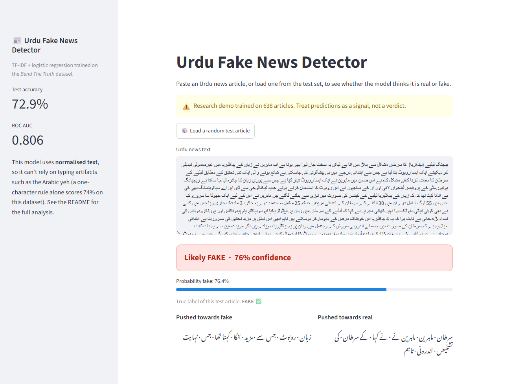
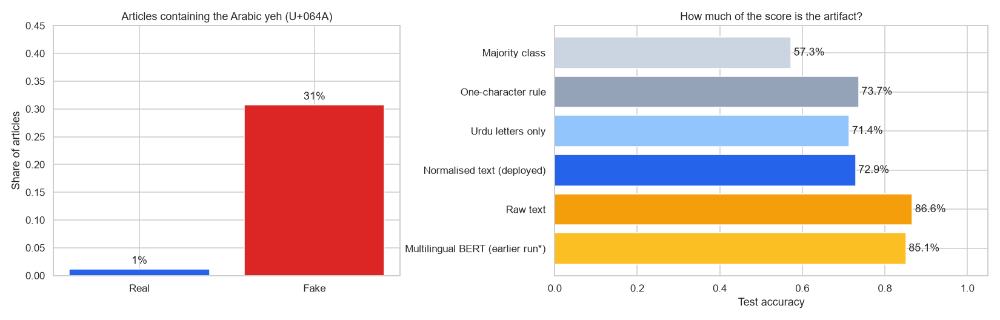
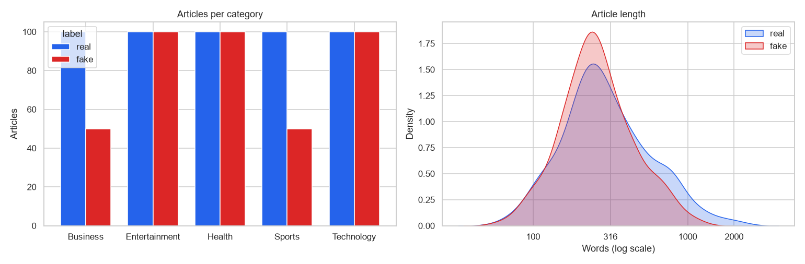
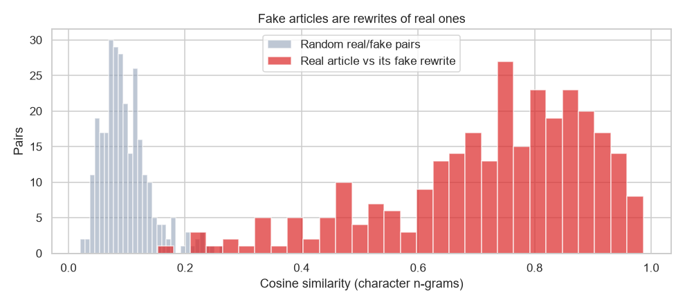
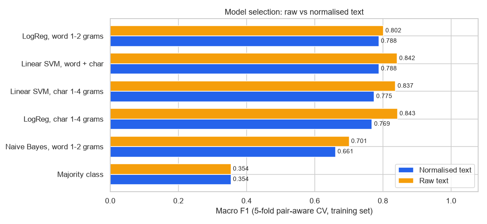
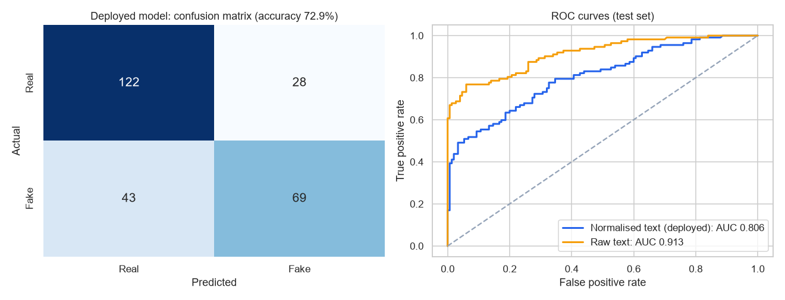
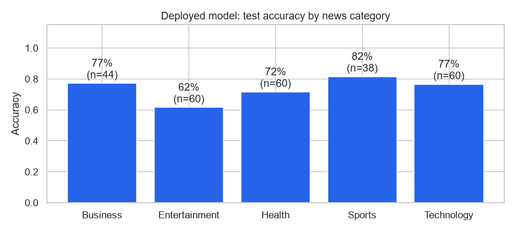

# Urdu Fake News Detection

Detects fake news in **Urdu** with TF-IDF features and linear models, and investigates **why** models score so well on this benchmark. A large part of the accuracy turns out to come from how the dataset was built rather than from the news content.



## Key findings

| Model / rule | Text used | Test accuracy | ROC AUC |
|---|---|---:|---:|
| Majority class | n/a | 57.3% | n/a |
| **One-character rule:** "contains Arabic yeh (U+064A) → fake" | raw | **73.7%** | n/a |
| Logistic Regression, char 1-4 grams | **raw** | **86.6%** | 0.913 |
| Logistic Regression, word 1-2 grams (**deployed**) | **normalised** | 72.9% | 0.806 |
| Same model, Urdu letters only | letters only | 71.4% | n/a |
| Multilingual BERT (*earlier run, see note*) | raw-ish | 85.1% | n/a |

1. **A fast linear model matches BERT.** Character n-grams with logistic regression reach **86.6%** on the official test set, slightly above the 85.1% from an earlier multilingual BERT fine-tune, and train in seconds on a CPU.
2. **But much of that comes from a typing artifact.** **31% of fake articles contain the *Arabic* yeh character (`ي`, U+064A), against 1% of real ones.** Real articles use the *Urdu* yeh (`ی`, U+06CC). The two look almost identical to a reader; the difference comes from the keyboard layouts the journalists used to write the fakes. That one invisible character alone predicts the label with **73.7%** accuracy.
3. **Other formatting differences point the same way.** Real articles, copied from news websites, contain more diacritics, Latin characters and punctuation. They also include caption boilerplate such as *تصویر کے کاپی رائٹ* ("image copyright"), which turns out to be the strongest "real" term.
4. **Once the artifacts are normalised away, accuracy drops to about 73%.** That's a more realistic estimate of how well the model reads *content*. The demo app uses this normalised model.



> **Note on the BERT result:** an earlier version of this project fine-tuned `bert-base-multilingual-cased` for 15 epochs on Colab and reported 85.1% accuracy. It was not re-run here. That setup used the test set to choose the best epoch (`load_best_model_at_end` with the test set as the evaluation set), so the number is slightly optimistic. Its text cleaning also kept the Arabic yeh, so it could exploit the same artifact.

## Dataset

[*Bend The Truth*](https://github.com/MaazAmjad/Datasets-for-Urdu-news) (Amjad et al., 2020): 900 Urdu articles (500 real, 400 fake) in five domains. The official split has 638 training and 262 test articles. Real articles come from mainstream news websites; each **fake article is a rewrite of a real one** by a professional journalist.

<p>
  
</p>

### Rewrite pairs and pair-aware validation

A real article and its fake rewrite share a file name and much of their wording (median similarity 0.76, against 0.09 for random pairs). If one half of a pair were in the training data and the other half in the validation data, scores would be inflated. The official split keeps pairs together, and all cross-validation here uses **`GroupKFold` grouped by pair**.



## Method

1. **Two versions of the text.** *Raw* keeps every character as typed. *Normalised* unifies Arabic/Urdu letter variants (`ي→ی`, `ك→ک`, `ۀ→ہ`) and removes diacritics.
2. **Model selection.** Six pipelines (majority baseline, Naive Bayes, logistic regression and linear SVM on word and/or character n-grams) were tuned with 5-fold pair-aware cross-validation on the training set only, scored by macro F1.
3. **Final evaluation.** The best pipeline for each text version was calibrated (sigmoid, pair-aware folds) and evaluated **once** on the held-out test set.
4. **Artifact analysis.** The one-character rule, an "Urdu letters only" variant, and the per-class rates of the artifacts.





### What the deployed model looks at

The most influential word n-grams (logistic regression on normalised text):

| Pushes towards **fake** | Pushes towards **real** |
|---|---|
| اس لیے ("therefore") | کاپی رائٹ ("copyright") |
| جو کہ ("which is") | تصویر کے ("of the image") |
| کہنا تھا ("had to say") | نے کہا ("said") |
| وجہ سے ("because of") | تاہم ("however") |
| انکا ("their", written joined) | دو / تین ("two" / "three") |

Fake articles lean on explanatory connectives and informal spellings. Real ones contain news-agency phrasing, numbers and image-caption boilerplate. The model learns *house style*, which is a reminder that benchmark accuracy doesn't automatically carry over to news from other sources.



## Demo app

`app.py` is a Streamlit app. Paste an Urdu article (right-to-left input, Nastaliq font) or load a random test article. It shows the prediction, the probability of being fake, the true label for test articles, and the words that pushed the prediction each way.

```bash
pip install -r requirements.txt
streamlit run app.py
```

The trained model is in `model/`. The app downloads the dataset from the authors' GitHub the first time it needs sample articles.

## Reproduce

```bash
git clone https://github.com/arslanahmedbhutto/urdu-fake-news-detection.git
cd urdu-fake-news-detection
pip install -r requirements.txt jupyter
python -c "from src.urdu_text import download_corpus; download_corpus()"
jupyter nbconvert --to notebook --execute urdu_fake_news_detection.ipynb
```

The full notebook (12 grid searches on a single CPU core) takes about 15 minutes.

## Project structure

```
urdu-fake-news-detection/
├── urdu_fake_news_detection.ipynb  # EDA, pair analysis, model selection, evaluation, artifacts
├── app.py                          # Streamlit demo
├── src/urdu_text.py                # Loading, normalisation, dataset download
├── model/fake_news_model.joblib    # Deployed model (normalised text)
├── results/                        # summary.json, cv_results.csv, artifacts.csv, top_terms.csv
├── data/README.md                  # Dataset source and citation
└── screenshots/
```

## Tech stack

Python · scikit-learn · pandas · NumPy · Matplotlib · Seaborn · Streamlit

## Citation

The dataset is by Amjad, M., Sidorov, G., Zhila, A., Gómez-Adorno, H., Voronkov, I. & Gelbukh, A. (2020). *Bend the Truth: A Benchmark Dataset for Fake News Detection in Urdu and Its Evaluation.* Journal of Intelligent & Fuzzy Systems, 39(2), 2457–2469.
